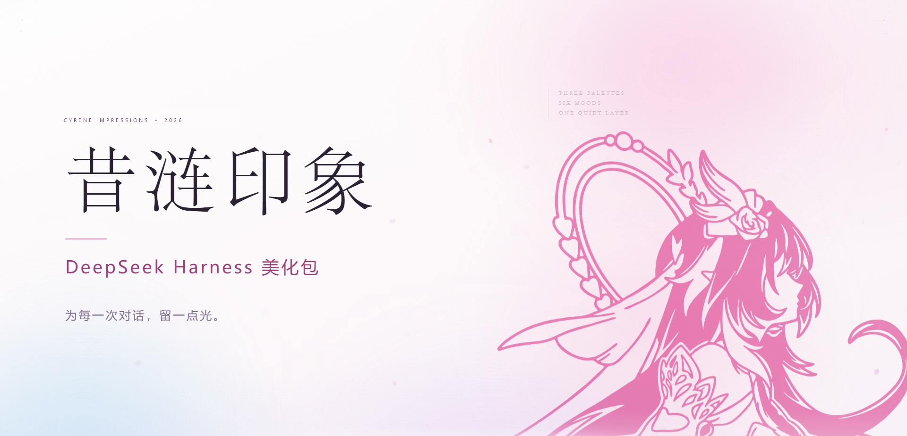
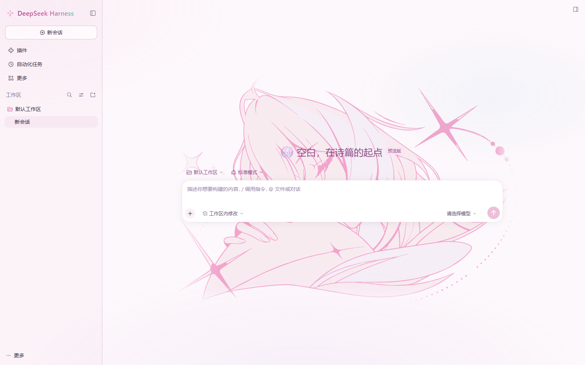

# 昔涟印象 · DeepSeek Harness 主题包

> 三套配色，六种气氛。给每一次对话，留一点光。

> **非官方同人作品**：与 miHoYo / HoYoverse、DeepSeek 均无隶属、合作或背书关系。  
> © 米哈游版权所有  
> 《崩坏：星穹铁道》素材的权利归米哈游所有，其他内容的相关权利、利益均归各自所有者享有。



「昔涟印象」是给 **DeepSeek Harness Web 界面** 的一层视觉主题。它不重排任何组件，也不改工作流：只在宿主已有的 `--dsw-*` 设计 token 上换一套颜色、圆角与阴影，再把侧栏品牌、开屏、对话水印这些位置轻轻接过来。

关掉它，界面立刻回到原样。



---

## 一分钟了解

| 项目 | 说明 |
| --- | --- |
| **适用** | DeepSeek Harness Desktop 的 Web 界面 |
| **配色** | 月白 · 潮汐 · 夜阑 |
| **明暗** | 跟随 Harness 的浅色 / 深色模式，每种配色各有一套 |
| **强度** | 「轻」只换配色与质感，「全」再加品牌位、氛围层、水印与音符 |
| **快捷键** | `Ctrl + Alt + X` 开关主题，`Ctrl + Alt + P` 调试面板 |
| **依赖** | 无 npm 运行时依赖，主题本身不发起网络请求 |
| **开关** | 地址栏 `?cyrene=off` 可强制素颜；`?cyrene=reset` 清空偏好 |

---

## 特点

### 三套配色，六种气氛

| 配色 | 浅色 | 深色 |
| --- | --- | --- |
| **月白**（默认） | 奶粉 + 藕荷，像晨光落在纸上 | 深紫夜色 + 一点粉光 |
| **潮汐** | 天空蓝 + 薄荷，干净、清透 | 深海蓝 + 冷光 |
| **夜阑** | 紫夜 + 粉光，安静、偏梦 | 近黑的紫 + 柔和霓虹 |

每套配色都会同时改写按钮、选中态、链接、代码块、滚动条、输入框、空状态等宿主 token；切换配色不需要重启。

### 侧栏品牌位

「全」档下，侧栏左上角换成四瓣花核图标和渐变字标；侧栏收起时也保持对齐。主题关掉后，品牌位会还原成宿主原来的鱼标与字标，不会留下一个空位。

### 开屏动画

- 角色立绘 + 一句问候，每次启动播一次；同一会话内刷新不会重复。
- 时长 **1–5 秒**、角色高度 **300–720 px**、底色可选白 / 粉。
- 五句问候用「洗牌袋」轮换，不会连续两次撞同一句。
- 点画面或按 `Esc` 可跳过；宿主自己的启动画面也会被一层同色封面接住，避免先闪一下原版界面。

### 对话线稿水印

对话区背景可以放一张矢量线稿水印，浅色 / 深色各一版，跟着主题一起换色。水印可以：

- 水平居中，或贴着右边；
- 上下拖动，避开输入框；
- 单独关闭，不影响配色。

### 「思考中」的音符

「全」档下，模型思考时的状态行会多一个用 CSS 画的 `♪`，轻轻跳动，不加载图片，也不改宿主的运行逻辑。系统开启「减少动态效果」时会自动安静下来。

### 氛围层

一层很淡的径向渐变，压在画布最底下。它只影响气氛，不影响文字对比度；不想要时可以一键关闭。

### 设置里能改

Harness 的 **设置 → 通用** 里会多出四行，全部中英双语：

| 行 | 能做什么 |
| --- | --- |
| **美化程度** | 「轻」/「全」两档 |
| **水印对齐** | 居中 / 右下 |
| **开屏动画** | 开 / 关 |
| **主题快捷键** | 点一下，按下新的组合；`Esc` 取消，可恢复默认 |

### 调试面板

`Ctrl + Alt + P` 打开一个浮动面板（Shadow DOM，样式不会漏到宿主）：

- 实时切换三套配色、强度、氛围层、对话水印、水印位置；
- 改侧栏品牌字样；
- 调整开屏时长、底色、角色大小，并立即重播；
- 复制当前 token / 诊断信息；
- **紧急恢复**：清空主题偏好，回到原版界面。

### 三条退路

| 场景 | 做法 |
| --- | --- |
| 只是想素颜 | `Ctrl + Alt + X`，或面板里点「关」 |
| 页面一加载就不对 | 地址栏加 `?cyrene=off` 再回车 |
| 想彻底清干净 | 面板「紧急恢复」；或卸载组合包；或 `?cyrene=reset` |

主题运行时只把偏好存在浏览器的 `localStorage['dsh.cyrene.v1']` 里，不写会话、不改 profile 文件。

---

## 安装

### 需要

- DeepSeek Harness Desktop **0.2.1-rc.5 或更新版本**（本包在此版本上开发与验证）。
- 只支持 **Web 界面**；TUI / headless 没有可装饰的页面。
- 安装前请确认没有同时装着旧版开发包或别的主题包，两个主题包会抢同一组插槽。

### 方式一：本地目录（推荐）

1. 下载 `dsh-theme-cyrene-0.37.0.zip`，解压到任意目录，例如：

   ```text
   D:\Plugins\dsh-theme-cyrene
   ```

   这个目录里应该能直接看到 `package.json`、`client.js`、`cordis.patch.yml`。

2. 打开 Harness 侧栏的 **插件** 页 → **添加插件**。
3. 把解压后的**文件夹绝对路径**粘贴进输入框，确认安装。
4. 安装完成后确认组合包处于**启用**状态。
5. 如果界面没有立刻变化，完全退出 Harness 再启动一次（客户端插件在启动时组装，只刷新页面不够）。

### 方式二：压缩包

1. 下载 `dsh-theme-cyrene-0.37.0.tgz`。
2. 插件页 → **添加插件** → 粘贴 `.tgz` 的**绝对路径**。
3. 后续同上。

### 方式三：命令行

如果 `dsh` 已经在 `PATH` 里：

```powershell
# 本地目录
dsh plugin --profile desktop add "D:\Plugins\dsh-theme-cyrene"

# 或 tgz
dsh plugin --profile desktop add "D:\Plugins\dsh-theme-cyrene-0.37.0.tgz"
```

### 方式四：GitHub

把仓库推到 GitHub 后，可以直接在 **添加插件** 里粘贴仓库地址；仓库根目录需要有本包的 `package.json` 和 `cordis.patch.yml`。

> 安装动作由 Harness 的插件管理器完成：它会登记 profile 依赖、把包加进 `dsh.profile.bundles`，并在 profile 的 `node_modules` 里建立链接。不要手动改 profile 的 `package.json`，否则升级时容易被覆盖。

### 卸载

插件页 → 已安装插件 → **昔涟印象 · 主题** → 卸载。  
卸载会移除依赖和组合包选择；如果品牌位没有立刻恢复，重启一次 Harness。

> 更细的安装、升级、卸载与排障步骤见 [docs/INSTALL.md](docs/INSTALL.md)。

---

## 用起来

安装并启用后，界面会直接变成「月白」。

- **`Ctrl + Alt + X`**：开关主题。关掉就是原版界面，立刻生效。
- **`Ctrl + Alt + P`**：打开调试面板。
- **设置 → 通用**：四行主题设置，适合不想记快捷键的人。
- **`?cyrene=off`**：本次访问强制关闭，不读本地偏好。
- **`?cyrene=reset`**：清空偏好并回到默认。
- 想只保留配色：把「美化程度」切到「轻」。

---

## 兼容性与边界

- **只覆盖设计 token**：主视觉通过 `--dsw-*` token 实现，不针对组件类名写布局；Harness 改版时最坏情况是某些颜色不生效，而不是把界面挤坏。
- **品牌位是插槽接管**：`cordis.patch.yml` 会禁用官方的 `@deepseek-ai/dsh-client-ui-brand-official` 行，以腾出 `sidebar.brand.mark` / `sidebar.brand.name` 两个单占位插槽。卸载本包后，这一行会恢复。
- **没有网络请求**：主题不调用 `fetch`、WebSocket 或遥测；开屏立绘、标题装饰、水印、签名都是包内资源。
- **减少动态效果**：系统开启 `prefers-reduced-motion` 时，风、花瓣、音符等动画会降级或停止。
- **版本差异**：DSH 仍在快速迭代。如果某个版本改了插槽名或官方品牌行 id，主题可能只生效一部分；先用 `?cyrene=off` 确认，再提 issue。

---

## 常见问题

**装完没变化？**  
先确认组合包已启用；再完全退出 Harness 重启。还不行就在地址栏加 `?cyrene=off` 对比，确认是不是主题没有加载。

**侧栏还是原来的鱼标？**  
说明官方品牌行还占着插槽。检查插件详情里 `ui-brand-official` 是否被禁用；如果你的 DSH 版本改了这个行 id，需要同步更新 `cordis.patch.yml`。

**开屏没有出现？**  
「轻」档默认不开开屏；到设置里把「开屏动画」打开。它每次启动只播一次，同一会话刷新不会重复。

**看不到对话水印？**  
把「美化程度」切到「全」，并确认「对话背景」是开着的；水印只在有对话内容的区域显示。

**和其他主题冲突？**  
同一时间只保留一个主题包。先卸载另一个，再安装这个。

**升级 Harness 后白屏？**  
地址栏加 `?cyrene=off`。如果能进，说明是主题与新版不兼容；卸载本包即可恢复。

---

## 包结构

```text
dsh-theme-cyrene/
├─ package.json          # DSH 组合包清单：dsh.bundle.patch / dsh.client
├─ index.js              # Host 半侧：挂载插件，注入启动封面
├─ client.js             # Browser 半侧：token、开屏、水印、面板、设置行
├─ cordis.patch.yml      # 插入本包，并让出侧栏品牌位
├─ locale/
│  ├─ zh.json            # 插件页显示的中文标题与描述
│  └─ en.json
├─ icon.svg              # 插件图标（原创四瓣花核）
├─ splash-art.svg        # 开屏立绘（同人美术，许可见 NOTICE）
├─ docs/
│  ├─ INSTALL.md         # 更细的安装 / 排障说明
│  └─ screenshots/
└─ README.md
```

`package.json` 里最关键的三段：

```json
{
  "dsh": {
    "bundle": { "patch": "./cordis.patch.yml" },
    "client": {
      "platform": "web",
      "inject": [
        "@deepseek-ai/dsh-client-ui-theme",
        "@deepseek-ai/dsh-client-ui-primitives"
      ]
    }
  }
}
```

- `dsh.bundle.patch` 让 Harness 把这个包当作组合包；
- `dsh.client` 让浏览器半侧在 Web 端装配；
- `inject` 只声明激活顺序，不把宿主包当 npm 依赖引入。

---

## 开发

没有构建步骤：`index.js` 和 `client.js` 都是可直接加载的 ES 模块。

```powershell
node --check index.js
node --check client.js
npm pack --dry-run
```

改完后，重新安装本地目录并重启 Harness 即可看到效果。代码里的注释保留了每一处选择的原因，遇到宿主升级可以先读注释再改。

---

## 许可与声明

- **代码**（`index.js`、`client.js`、`cordis.patch.yml`、`locale/*.json`、`icon.svg`）采用 [MIT License](LICENSE)。
- **角色相关美术**（`splash-art.svg`，以及 `client.js` 中内嵌的开屏立绘、标题装饰、对话水印、签名）是**非官方同人作品**，不属于 MIT 授权范围。详见 [NOTICE](NOTICE)。
- 「昔涟 / Cyrene」「崩坏：星穹铁道 / Honkai: Star Rail」相关名称与角色版权归 **miHoYo / HoYoverse** 所有。本项目与 miHoYo / HoYoverse、DeepSeek 均无隶属或背书关系，仅供非商业的同人使用。
- 如果版权方认为某份资源不适合公开分发，请通过仓库 issue 联系，我会尽快移除对应文件。

---

## 致谢

- [DeepSeek Harness](https://github.com/deepseek-ai) 提供插件与主题机制。
- 昔涟的角色设计与世界观属于 miHoYo / HoYoverse。
- 以及每一位愿意给工作界面留一点光的人。
